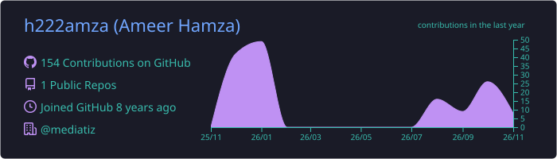
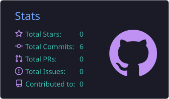

  

  

  
  
  

---

## 👋 About Me

- 🛠️ **DevOps & Cloud Engineer** building CI/CD pipelines that take code from commit to cloud — securely.
- 🐳 Containerize everything with **Docker** and ship to **AWS** (ECS, EKS, VPC, ALB, Auto Scaling, Aurora).
- 🔐 **DevSecOps** mindset: secret scanning, image scanning, keyless cloud auth with **OIDC**, least-privilege IAM.
- ⚙️ Pipelines in **GitHub Actions** and **Jenkins**; config with **Ansible**; workloads on **Kubernetes**.
- 🌱 Currently deepening: **Terraform**, **GitOps (Argo CD)** and **observability** (Prometheus + Grafana).
- 🏢 @mediatiz · 📍 Pakistan · open to remote

 

## 🧰 Tech Stack

  
   
  

## 🚀 Featured Projects

| Project | What it shows | Stack |
|---|---|---|
| [**laravel-lms-project-devsecops**](https://github.com/h222amza/laravel-lms-project-devsecops) ⭐ | Laravel + React LMS with a DevSecOps pipeline and keyless (OIDC) AWS deployment to ECS | Docker Compose · GitHub Actions · AWS ECS · OIDC |
| [**Devops-Project-1**](https://github.com/h222amza/Devops-Project-1) | Full-stack app shipped to AWS EKS via Jenkins with Slack alerts and monitoring | Jenkins · Kubernetes · EKS · MySQL |
| [**aws-3-tier-web-application**](https://github.com/h222amza/aws-3-tier-web-application) | Highly available 3-tier architecture: VPC, public/private subnets, ALBs, Auto Scaling, Aurora | AWS · Jenkins |
| [**cicd-pipeline-mega-project**](https://github.com/h222amza/cicd-pipeline-mega-project) | 3-tier app behind Nginx, orchestrated with Docker Compose, with Gitleaks secret scanning | Docker · Nginx · Gitleaks |
| [**Hamza-DevOps-1**](https://github.com/h222amza/Hamza-DevOps-1) | Java/Maven app through Jenkins & GitHub Actions to Kubernetes, configured with Ansible | Jenkins · K8s · Ansible |
| [**laravel-app-dockerization**](https://github.com/h222amza/laravel-app-dockerization) | Dockerized Laravel WebSockets chat app with CI | Docker · PHP · GitHub Actions |

## 📊 GitHub Stats

<!-- Cards are generated daily by .github/workflows/profile-summary-cards.yml (no third-party server to go down) -->

  

<!-- Once project repos are public, add:

  
  

-->

  

## 🐍 Contribution Snake

<picture>
  <source media="(prefers-color-scheme: dark)" srcset="https://raw.githubusercontent.com/h222amza/h222amza/output/github-snake-dark.svg" />
  <source media="(prefers-color-scheme: light)" srcset="https://raw.githubusercontent.com/h222amza/h222amza/output/github-snake.svg" />
  
</picture>

## 🤝 Connect

  
  <!-- Add your LinkedIn: replace YOUR-LINKEDIN and uncomment
  
  -->

  

